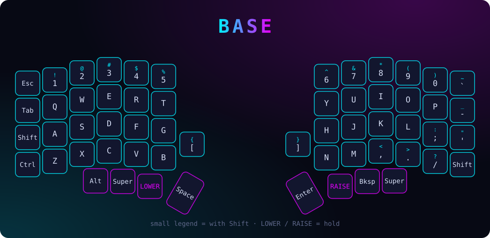
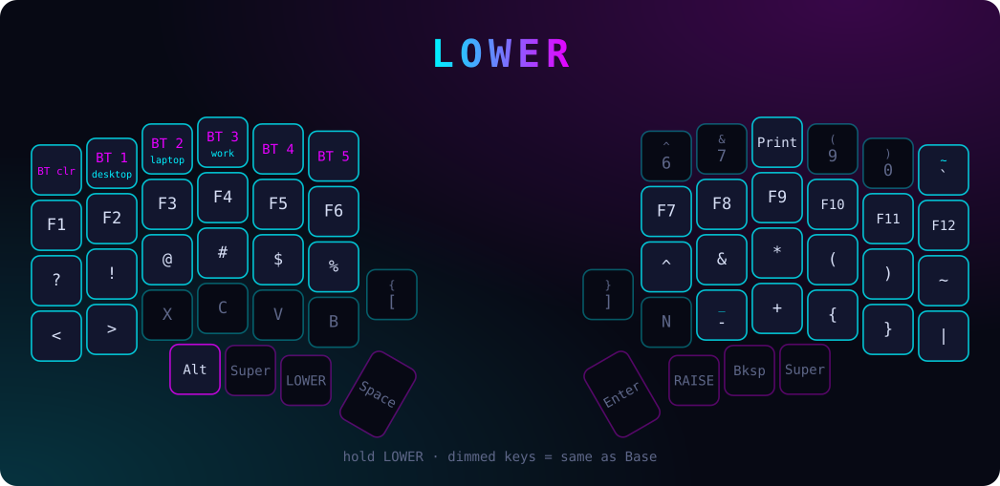
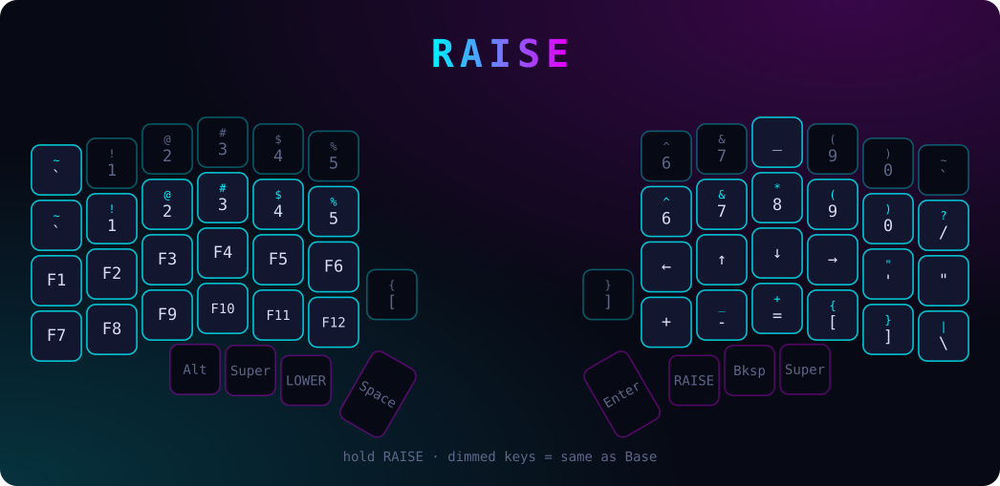
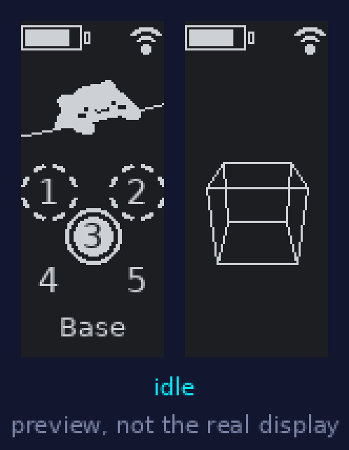

# ⌨️ Lily58 keyboard

Wireless Lily58 (two nice!nano v2 + two nice!view, Kailh Choc hotswap) running ZMK. The keymap and the firmware live in their own repository: [rotten_lily58_keymap_config](https://github.com/PoUrRiTuRe/rotten_lily58_keymap_config) (`config/lily58.keymap`). GitHub Actions builds the `.uf2` files there.

## Layers

`LOWER` and `RAISE` are held with the thumbs. Dimmed keys fall through to the base layer.







- **Bluetooth**: `Lower + 1/2/3` select the desktop / laptop / work profiles, `Lower + Esc` clears the **active** profile (see [Re-pair a ZMK Bluetooth keyboard](arch-notes.md#re-pair-a-zmk-bluetooth-keyboard)).
- **Encoder** (if fitted): volume up / down on every layer.
- ZMK Studio is enabled: a keymap changed live in Studio is stored on the keyboard and can differ from the file (and from these pictures).
- Editing the keymap: [keymap-editor](https://nickcoutsos.github.io/keymap-editor/) (works from a phone browser too) only changes `config/lily58.keymap`; the custom screens live in other files and keep working, and the bongo cat follows the physical key positions. Redraw the pictures above afterwards.
- The keyboard also pairs with a phone like any Bluetooth keyboard (one profile per device).

To redraw the pictures after a keymap change:

```bash
python3 assets/keymap/make-keymap.py ~/rotten_lily58_keymap_config/config/lily58.keymap assets/keymap
```

## Screens

Custom `nice_view_rotten` shield in the keymap repository:



*Preview only, not contractual 😄: drawn on a computer with approximate fonts and shapes. The real screen uses the firmware's own fonts; the Bluetooth rings, numbers, battery and link icons are ZMK's stock ones.*

- **Left half**: battery, output, Bluetooth profiles and layer as on the stock screen; the classic **bongo cat** replaces the WPM graph. It taps **like in a mirror**: keys of the left half use the paw on the right of the screen (the cat's left paw), keys of the right half the paw on the left. The paw goes down **as soon as a key is pressed** and **stays down while that key is held** (Ctrl, Shift…; only the last pressed key counts, so fast typing does not look like a hold). A second press on the same side lifts it for a moment first, so a double letter (the "ss" of "discussion") or a hammered key shows every tap. Idle animation 1.5 s after the paw is lifted.
- **Right half**: battery and link as on the stock screen, then the **Arch Linux logo**, a **spinning wireframe cube** (the biggest item, loops every 14.4 s without a jump) and an **atom symbol in a ring**, with the same gap between every item.

Back to the stock screens: `nice_view` instead of `nice_view_rotten` in its `build.yaml`. To redraw the preview: `python3 tools/preview.py screens.gif` in the keymap repository, then copy it to `assets/keymap/`.

## Flashing

1. Keymap repository → **Actions** → latest green run → download the `firmware` artifact.
2. Plug a half in, double-tap its reset button: a USB drive appears.
3. Copy that half's `.uf2` onto it (`lily58_left…` or `lily58_right…`); it reboots by itself. Repeat for the other half.

A ZMK dongle (both halves become peripherals) is described in [zmk-dongle.md](zmk-dongle.md).
