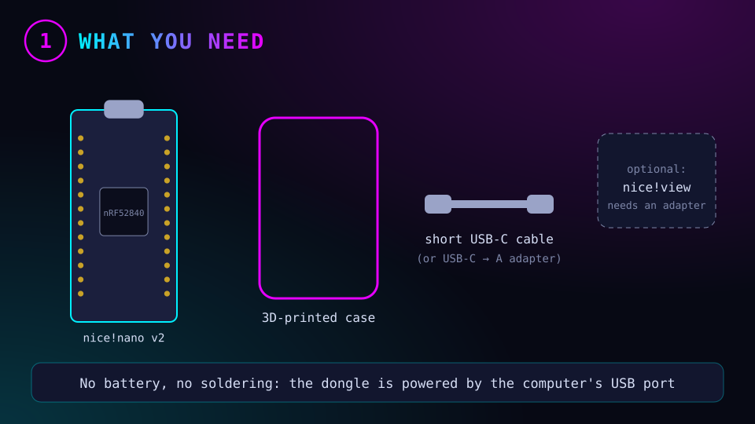
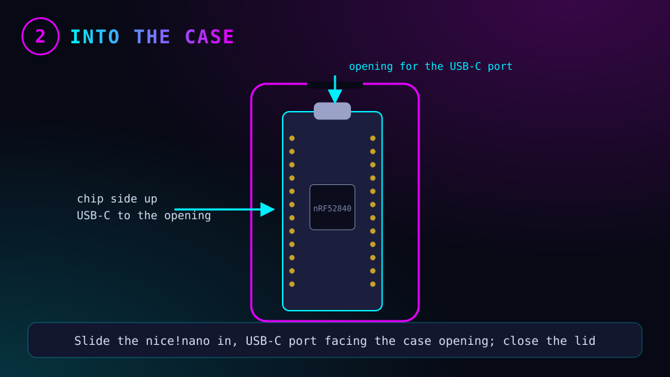
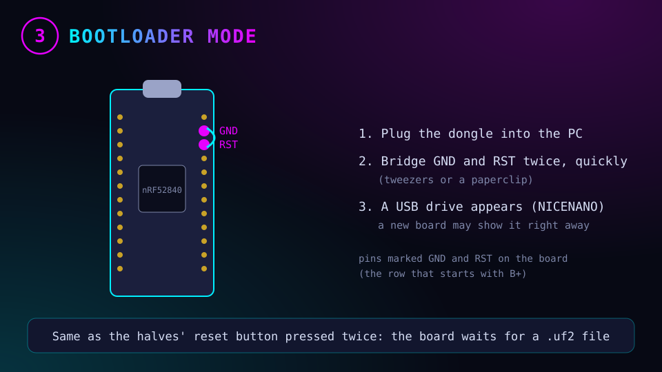
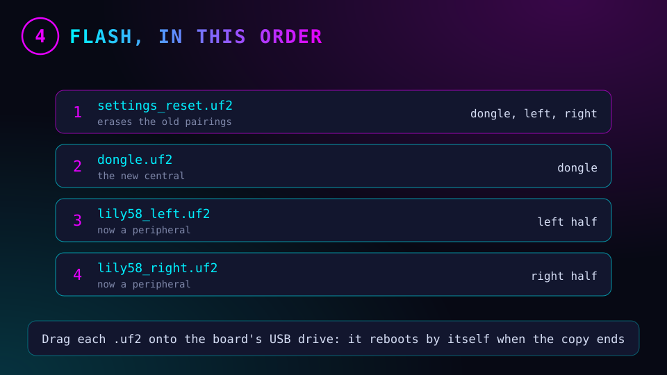
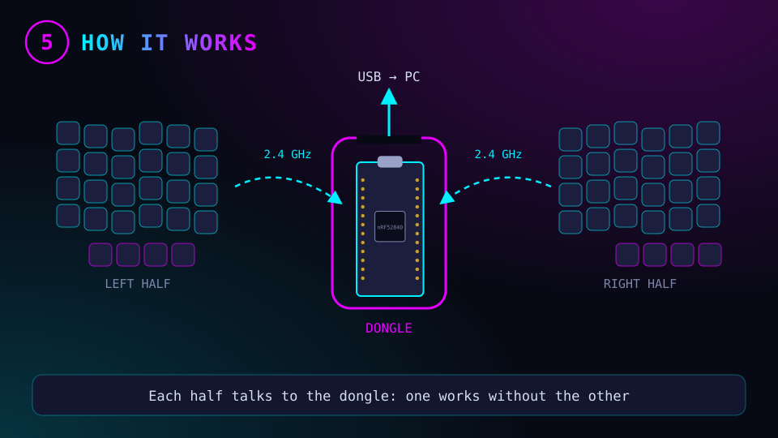
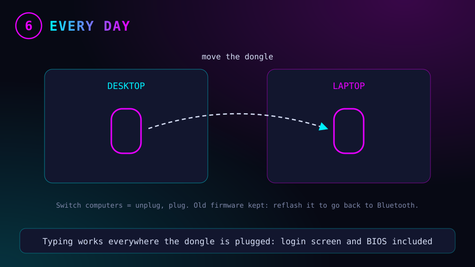

# 🔌 ZMK dongle for the Lily58

A **dongle** is a third ZMK board, plugged into the computer by USB, that becomes the keyboard's **central**. Both halves become equal **peripherals** that talk to it over the nRF52840's 2.4 GHz radio (Bluetooth LE).

- No Bluetooth pairing on the computer: the dongle is a plain USB keyboard (works on the login screen and in the BIOS).
- Each half works without the other (today the right half needs the left one).
- Better battery life for the left half, which no longer talks to the computer.
- To change computers, move the dongle. The Bluetooth profiles (`Lower + 1/2/3`) are no longer used; the old firmware can be flashed back at any time.

Nothing is opened or soldered on the keyboard: only its firmware changes.

## Parts

| Part | Notes |
|---|---|
| **nice!nano v2** | Same board as in the halves (Typeractive sells it). Headers not needed without a screen |
| Case | 3D printed: search "nice!nano dongle case" on Printables |
| Short USB-C cable or USB-C → A adapter | The dongle is powered by USB: no battery |
| *Optional:* **nice!view** | **Not plug-in on a bare nice!nano**: its 5 pins must reach specific nano pins. Needs a small dongle adapter PCB or soldered wires; skip it for a solder-free build |

## Steps

To enter the bootloader, bridge the **GND** and **RST** pins twice quickly (tweezers or a paperclip), like pressing a reset button twice. A new nice!nano may show its USB drive as soon as it is plugged in. On the halves, use their reset button as usual.

The firmware files are built by GitHub Actions in the `zmk-config` repository once the dongle is added to its build matrix: dongle as central, both halves as peripherals. Flash `settings_reset` on all three boards first, so the halves forget the pairings they had with each other.

## Going back

Keep the current `lily58_left.uf2` / `lily58_right.uf2`: flash `settings_reset`, then those files, and the keyboard is back to direct Bluetooth (left half as central). Pair it again on each computer (`docs/arch-notes.md`, ZMK section).

The diagrams are generated by `assets/dongle/make-diagrams.py` (same colors and font as the rest of the repository).
